<!-- Edit src/, run `node src/build.mjs`, and commit the generated assets. -->

<picture>
  <source media="(prefers-color-scheme: dark)" srcset="./assets/profile-dark.svg">
  
</picture>

### I'm Andreas.

I build **AI systems, market tools, and interfaces**. I'm interested in learned structure, long-running software, and making complex things feel simple.

### Selected work

Most of my work is private. Here's a small public selection.

**[project-x](https://github.com/ni1ra/project-x)** &nbsp; C++ · AI research Experimental intelligence that grows its own learned structure.

**[navi-ui](https://github.com/ni1ra/navi-ui)** &nbsp; TypeScript · Interface design A blueprint-driven theme and component system for React.

**[dartio](https://github.com/ni1ra/dartio)** &nbsp; TypeScript · Application Darts scoring, practice, AI opponents, and multiplayer.

**[wired](https://github.com/ni1ra/wired)** &nbsp; Rust · Research A concept-based AI brain with memory, reasoning, and tools.

 

TypeScript · Rust · C++ · Python

Every line of code needs a reason to exist.
